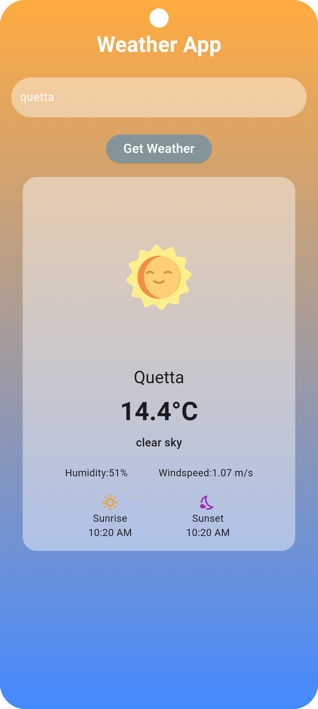
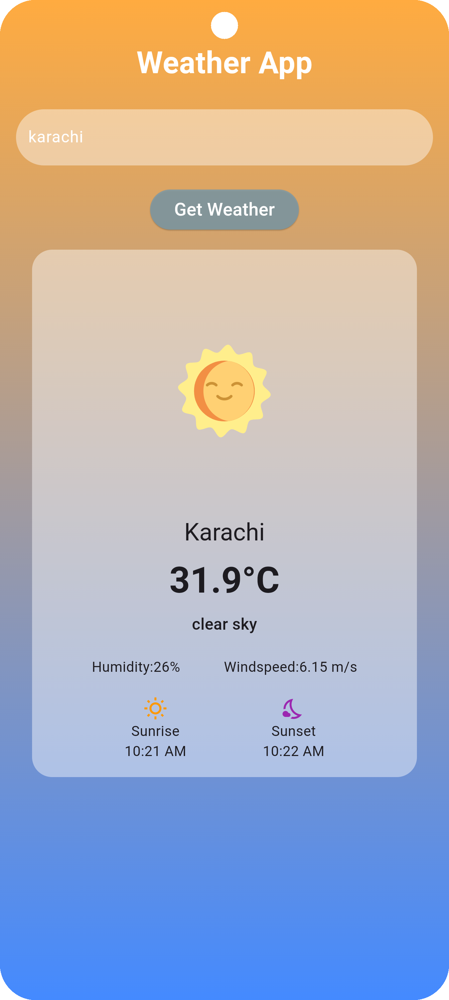

# 🌦️ Weather App – Flutter

## 📸 App Screenshots

A simple and user-friendly Weather App built with **Flutter and Dart** that provides real-time weather information using a Weather API.

## ✨ Features

- 🌡️ Display current temperature
- 🌤️ Show weather conditions and descriptions
- 💨 Display wind speed
- 💧 Show humidity levels
- 🌅 Sunrise and sunset timings
- 🌍 Get weather information for a city
- 🔄 Fetch live weather data using API integration

## 🛠️ Technologies Used

- Flutter
- Dart
- REST API
- HTTP Package
- JSON Parsing

## 📱 About the Project

This project was developed to improve my Flutter development skills and gain practical experience with API integration, JSON data handling, asynchronous programming, and building responsive user interfaces.

## 👨‍💻 Developer

**Ahmed Raza**

Flutter Developer | Learning & Building Mobile Applications

GitHub: https://github.com/09111994

---

⭐ If you like this project, feel free to explore the repository!
